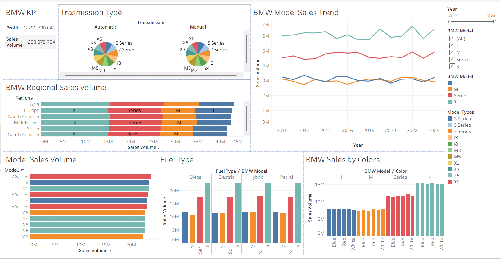
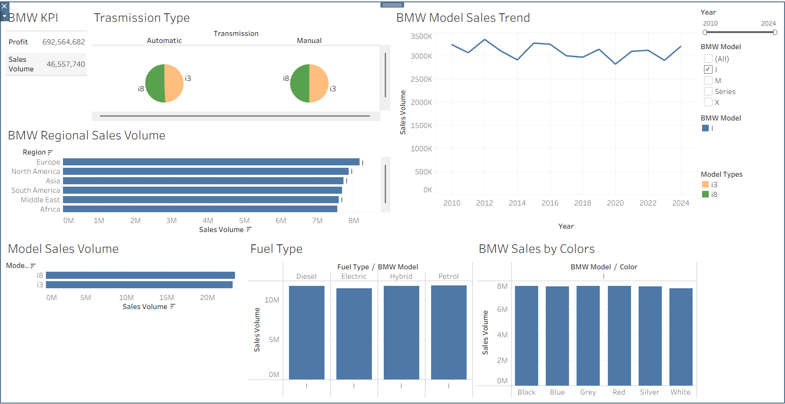
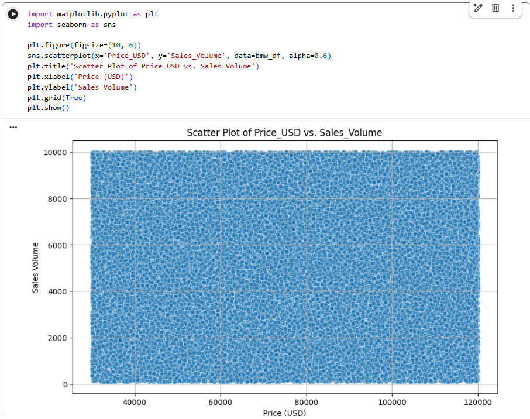

# BMW Sales Performance Analysis (2010–2024)

**Business problem:** What drives BMW's sales volume: the product (model, price, fuel type, colour, transmission) or the market (region)?
**What I did:** Cleaned and analysed 50,000 sales records in Python and Excel, ran correlation and multiple regression, and built an interactive Tableau dashboard.
**Result:** Vehicle attributes explain almost none of the variation in sales (R² ≈ 0). Model range and region matter more, so BMW should focus on market-level strategy rather than individual product features.

---

## Business questions
1. Which models and model families sell the most?
2. Do price, fuel type, colour or transmission influence sales volume?
3. Which regions lead, and which are growing?

## Dataset
- **Source:** BMW sales data (2010–2024), sourced via [abdelazizelserty's Kaggle notebook](https://www.kaggle.com/code/abdelazizelserty/bmw-sales-data/notebook)
- **Size:** 50,000 records, 11 variables (categorical, numerical and date)
- **Target variable:** `Sales_Volume`
- **Predictors:** Model, Engine type, Fuel type, Colour, Transmission, Price (USD), Region

## Approach
1. **Data cleaning:** checked for missing values and duplicates (none found), and converted data types (categorical fields, `Price_USD` to numeric).
2. **Data wrangling:** grouped individual models into four families (Series, X, M, i), applied one-hot encoding to categorical variables, and dropped redundant fields.
3. **Exploratory analysis:** descriptive statistics and pivot tables by region, fuel type and model.
4. **Statistical modelling:** correlation analysis and multiple linear regression to test which attributes predict sales volume.
5. **Visualisation:** interactive Tableau dashboard showing sales by model, region and attribute over time.

## Key findings
- **Product attributes don't predict sales.** The regression model returned an R² close to zero with non-significant p-values, and price showed no correlation with sales volume.
- **Demand is stable despite premium pricing.** The average price is about $76,000, yet sales volume stayed consistent across 2010–2024.
- **X models lead sales,** followed by the Series range. The 7 Series and i8 are the top individual models. M models show a slight decline in recent years.
- **Asia is the largest market, and Europe is growing fastest,** with potential to overtake it.
- **Fuel type, colour and transmission show near-identical sales,** so they have minimal impact on demand.

## Recommendation
Prioritise **model range expansion** and **growth markets such as Europe** over fine-tuning individual product features.

## Limitations
- The dataset lacks key external drivers such as customer income, purchase purpose and brand perception.
- Sales values are spread almost perfectly evenly between about 100 and 10,000 units, which suggests the data may be synthetic. Treat the findings as directional, and validate them with real market data before acting on them.
- Regression results show association, not causation.

## Tools
Python (pandas, statsmodels, seaborn) · Excel (pivot tables) · Tableau · Google Colab

## Dashboard
Tableau dashboard showing sales volume by model family, region, fuel type, colour and transmission, with year and model filters.

**Drill-down example (i models only):** Europe leads, and sales are near-identical across fuel types and colours.

## Price vs sales volume
The points spread evenly across the whole chart, which means there is no relationship between price and sales volume.

## Files
| File | Description |
|---|---|
| `bmw_sales_analysis.ipynb` | Data cleaning, wrangling, EDA and regression |
| `images/` | Dashboard and chart screenshots |
| `requirements.txt` | Python packages needed to run the notebook |
| `bmw_sales_report.pdf` | Full analysis report: methodology, regression results and recommendations |

> The dataset is not included in this repo. Download it from the Kaggle link above and place it in a `data/` folder to run the notebook.

---
*Completed as part of the Master of Information Technology (Adelaide University), Emerging Technologies, Data and Business Analytics course.*
